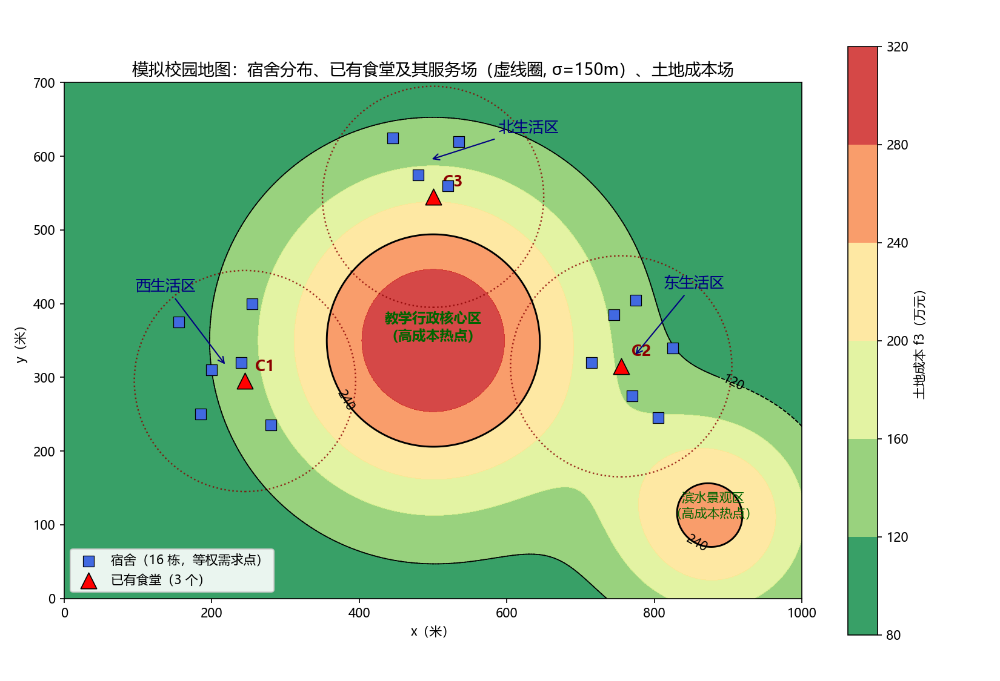

# 校园新增食堂三目标 MOEA/D 问题建模与可行性验证报告

> 项目阶段：第一阶段（问题建模与可行性验证）
> 本报告**不包含** MOEA/D 实现。所有结论基于 6000 个随机候选位置的数值实验。

---

## 0. 摘要与总结论

本报告为"校园新增 1 个食堂选址"问题建立了三目标最小化模型（f1 平均距离 / f2 竞争重叠度 / f3 土地成本），并用均匀随机采样（n=6000）对目标空间结构做了可行性验证。

**总结论：**

| 检验项 | 结论 | 证据 |
|---|---|---|
| f1–f2 是否 trade-off | **是，强 trade-off** | Spearman ρ = −0.890；成对前沿覆盖 f1 全程 89.4%、f2 全程 92.3% |
| f1–f3 是否 trade-off | **是，明显 trade-off** | Spearman ρ = −0.720；成对前沿覆盖 f1 全程 99.8%、f3 全程 89.3% |
| f2–f3 是否 trade-off | **否，近似冗余（方向一致）** | Spearman ρ = +0.624；成对二维前沿仅 3 个点，跨度 <3%；前沿内部 ρ = +0.734 |
| 三目标是否冗余 | **部分冗余：f2 与 f3 结盟，但非完全重复** | 三维 Pareto 前沿 2421 点（占样本 40.4%），是一张真实的二维曲面；f2、f3 在前沿上仍有独立变化（如东南滨水区贵但竞争低） |
| 能否形成合理 Pareto 前沿 | **能** | 前沿覆盖三个目标的全值域（f1: [269, 650] m，f2: [0.003, 0.387]，f3: [80, 320] 万元），结构清晰可解释 |
| 是否可直接进入 MOEA/D 阶段 | **可以，但建议先做 3 项小修正**（见第 8、9 节） | — |

**本质冲突结构**：本问题的核心矛盾是单一主轴——"**靠近学生（f1 ↓）必然靠近已有食堂（f2 ↑）且靠近昂贵核心区（f3 ↑）**"。f2 与 f3 是"盟友"而非"对手"：避开竞争与低价土地指向同一类区域（安静、便宜的校园边缘）。这符合校园选址的现实直觉，但意味着三目标问题的**有效冲突维度接近 2**，MOEA/D 的部分权向量方向（专门权衡 f2 与 f3）收益有限。此发现不影响 MOEA/D 学习可行性，但应在下一阶段知情决策。

---

## 1. 决策变量

| 变量 | 含义 | 取值域 |
|---|---|---|
| x | 新增食堂在校园地图上的横坐标（米） | [0, 1000]（连续） |
| y | 新增食堂在校园地图上的纵坐标（米） | [0, 700]（连续） |

决策变量**只有** X = (x, y)，二维连续，决策空间即校园平面区域 1000m × 700m = 0.7 km²。无整数变量、无层级变量。

---

## 2. 输入数据：模拟校园设计（第一阶段）

### 2.1 设计总览

| 要素 | 设定 | 规模 |
|---|---|---|
| 校园范围 | [0,1000] × [0,700]（米），原点在西南角 | 70 万 m² |
| 宿舍（需求点，等权） | 三个生活区：西区 6 栋、东区 6 栋、北区 4 栋 | 16 栋 |
| 已有食堂（竞争参考点） | C1 西区内、C2 东区内、C3 北区南缘 | 3 个 |
| 土地成本场 | 基准 80 万 + 两个高成本高斯热点 | 连续场 |



### 2.2 宿舍坐标（16 栋，等权）

```
西生活区（6 栋，质心约 (219, 315)）:
  (185,250) (240,320) (155,375) (280,235) (255,400) (200,310)
东生活区（6 栋，质心约 (773, 328)）:
  (770,275) (825,340) (745,385) (805,245) (715,320) (775,405)
北生活区（4 栋，质心约 (495, 595)）:
  (480,575) (535,620) (445,625) (520,560)
```

全校宿舍总质心 ≈ **(496, 390)**——位于校园中部偏北，紧邻高成本核心区。这是刻意的结构性设计（见 2.5）。

### 2.3 已有食堂坐标

```
C1 = (245, 295)   西生活区内，稍偏东南
C2 = (755, 315)   东生活区内，稍偏西
C3 = (500, 545)   北生活区南缘（主干道旁）
```

### 2.4 土地成本场（人为构造）

$$f_3(x,y) = 80 + 240 \cdot e^{-\frac{\|(x,y)-(500,350)\|^2}{2 \cdot 160^2}} + 170 \cdot e^{-\frac{\|(x,y)-(880,110)\|^2}{2 \cdot 100^2}}$$

- **基准成本 80 万元**：校园边缘空地。
- **热点 1：教学行政核心区**，中心 (500, 350)、峰值 +240、σ=160 m——覆盖校园几何中心与总质心附近。
- **热点 2：东南滨水景观区**，中心 (880, 110)、峰值 +170、σ=100 m。
- 等值线 120 万元以下为低成本区，120–240 为中成本区，240 以上为高成本区（见地图黑色虚线）。

### 2.5 为什么这样设置（设计理由）

每一项都服务于"制造有现实依据的目标冲突"，同时保持可解释性：

1. **宿舍分三群而非均匀散布**：现实校园宿舍总是成生活区聚集。三群结构使 f1 的最优点（总质心 (496,390)）**不与任何一个生活区重合**——新食堂无论建在哪个生活区，都要付出对另外两区的远距离代价。这保证 f1 有非平凡的权衡空间。
2. **已有食堂建在生活区内但不与质心重合**：现实中食堂就在宿舍旁边（学生步行 1–3 分钟）。这使"靠近学生"（f1）与"避开已有食堂"（f2）**天然冲突**——宿舍群和食堂群在空间上高度重叠但不完全重合，留给 f1–f2 权衡的"缝隙"来自三个食堂的偏移量与北区食堂的南移。
3. **高成本核心区放在校园几何中心（教学行政楼集中地）**：现实核心区土地机会成本最高，而它恰好覆盖/紧邻宿舍总质心——**f1 的最优区正好是 f3 的最差区**，制造 f1–f3 冲突。
4. **东南滨水景观区作为第二个热点**：提供一个"贵但离食堂远"的区域，故意让 f2 与 f3 **不完全绑定**，避免两目标退化为完全冗余。
5. **规模选择**（1000×700、16 栋宿舍、3 个食堂、2 个热点）：足够复杂以产生非平凡前沿，又足够小以便人工检验任一位置的三个目标值。

---

## 3. 目标函数定义（第二阶段）

全部为**最小化**目标。以下 X=(x,y) 为决策变量，H_i 为第 i 栋宿舍坐标（i=1..n, n=16），C_j 为第 j 个已有食堂坐标（j=1..m, m=3）。

### 3.1 f1：学生到新食堂的平均距离

$$f_1(X) = \frac{1}{n} \sum_{i=1}^{n} \sqrt{\|X - H_i\|_2^2}$$

- **输入**：候选位置坐标 X；**输出**：非负实数，单位米；采样值域 [268.97, 650.46] m。
- **现实意义**：新食堂对全校学生的整体可达性（服务公平性/平均步行距离）。
- **设计决策（重要）**：f1 定义为"到**新**食堂的距离"，而非"到**最近**食堂（含已有食堂）的距离"。理由：
  - 若采用后者，最小化会系统地把新食堂推离已有食堂（去填补服务空白），与 f2（避开已有食堂）**同向**，两目标将高度冗余；
  - min(·) 算子引入非光滑性，对后续基于分解的算法和权重敏感性分析不友好。
  - **代价**：f1 隐含"所有学生都改去新食堂"的强假设，不反映真实的可达性改善。此假设的敏感性对比列入下一阶段建议（第 9 节）。

### 3.2 f2：与已有食堂的服务范围重叠度（竞争程度）

$$f_2(X) = \frac{1}{m} \sum_{j=1}^{m} \exp\!\left( -\frac{\|X - C_j\|_2^2}{2\sigma_s^2} \right), \qquad \sigma_s = 150 \text{ m}$$

- **输入**：X；**输出**：[0,1] 无量纲；采样值域 [0.0034, 0.3865]。
- **现实意义**：每个已有食堂拥有以 σ_s 为特征半径的高斯服务场（学生选择概率随距离衰减的简化）。f2 是新位置被三个服务场覆盖的平均强度——新食堂若建在已有食堂服务核心区，将直接分流后者的客流；建在服务场之外则各自服务不同人群。
- **参数依据**：σ_s = 150 m 对应"步行 3 分钟"的典型食堂服务半径，与宿舍-本区食堂的实际距离（约 50–130 m）同量级。

### 3.3 f3：土地/建设成本

$$f_3(X) = c_0 + \sum_{k} A_k \exp\!\left( -\frac{\|X - P_k\|_2^2}{2 s_k^2} \right)$$

参数：c₀ = 80，热点 {(P_k, A_k, s_k)} = {((500,350), 240, 160), ((880,110), 170, 100)}，单位万元。

- **输入**：X；**输出**：≥ 80 的正实数，单位万元；采样值域 [80.18, 319.95]。
- **现实意义**：核心地段（行政教学区、滨水景观区）拆迁/机会成本高，边缘空地便宜。连续高斯场是"分区地价"的光滑近似，保证 f3 处处可微、无分区边界的跳变，对后续梯度分析和分解算法更友好。

### 3.4 三目标的现实意义检查（用户要求）

| 目标 | 现实对应 | 是否独立指标 |
|---|---|---|
| f1 | 学生整体步行可达性（需求侧服务质量） | 是——由**宿舍分布**驱动 |
| f2 | 商业竞争/客流分流风险（供给侧竞争） | 是——由**已有食堂分布**驱动 |
| f3 | 建设预算约束（土地成本） | 是——由**成本场**驱动 |

三个目标各自有独立的数据来源（宿舍 / 食堂 / 成本场）与独立的利益相关方（学生 / 食堂运营方 / 学校财务），**没有为制造冲突而人为添加无现实意义的指标**。但"数据来源独立"不等于"最优解方向独立"——由于食堂建在宿舍区旁、核心区在校园中心，f2 与 f3 在空间上部分结盟（详见 6.4 节），这是现实结构的忠实反映而非建模错误。

---

## 4. 约束

| 约束 | 表达 | 类型 |
|---|---|---|
| 校园边界 | 0 ≤ x ≤ 1000 且 0 ≤ y ≤ 700 | 盒约束（唯一约束） |

按用户要求，本阶段不考虑容量、交通、不可建区等复杂约束。

**已观察到的边界问题**（见 8.3 节）：f2、f3 的单目标最优解落在校园角点（如 (7,700)、(1,6)），提示矩形边界存在"贴边 artifact"，建议下一阶段加入内缩边界（如距围墙 ≥ 30 m）。

---

## 5. 验证实验设计与参数（第三阶段）

| 参数 | 值 | 说明 |
|---|---|---|
| 采样数 N | 6000 | 满足"≥5000"要求 |
| 采样方式 | 决策空间均匀随机（`numpy.default_rng(42)`） | 均匀覆盖而非聚集，保证目标值域完整 |
| 统计量 | Spearman 秩相关 | 对非线性单调关系稳健；量纲无关 |
| 前沿提取 | 朴素非支配排序（3D）+ 扫描法（2D 成对） | 独立实现，无进化算法参与 |
| 冗余判据 | ①\|ρ\|≥0.95 视为严重冗余；②成对 2D 前沿退化（点数极少/跨度占比<5%）视为无冲突 | 双证据制，避免只看相关系数误判 |

代码：`src/campus_model.py`（数据+目标函数）、`src/validate.py`（验证实验）、`src/make_figures.py`（图表）。运行方式见附录。

---

## 6. 验证结果

### 6.1 相关性分析

| 目标对 | Spearman ρ | Pearson r | 判读 |
|---|---|---|---|
| f1–f2 | **−0.890** | −0.875 | 强负相关 → 最小化方向相反 → **trade-off** |
| f1–f3 | **−0.720** | −0.613 | 中强负相关 → **trade-off** |
| f2–f3 | **+0.624** | +0.551 | 中等正相关 → 最小化方向**一致** → 无冲突，有结盟倾向 |

负相关（f1 与 f2、f3）正是"靠近学生的地方又挤又贵"的空间结构在统计上的表现。正相关（f2 与 f3）说明"避开竞争"与"低价土地"大体指向同一批候选位置（安静的校园边缘）。

### 6.2 成对 trade-off 分析（二维前沿）

| 目标对 | 2D 前沿点数 | f_A 前沿跨度占比 | f_B 前沿跨度占比 | 判读 |
|---|---|---|---|---|
| f1–f2 | 188 | 89.4% | 92.3% | **健康 trade-off**：沿前沿移动可大幅交换两目标 |
| f1–f3 | 397 | 99.8% | 89.3% | **健康 trade-off**：f1 全值域几乎都可成为前沿 |
| f2–f3 | **3** | **2.7%** | **0.0%** | **前沿退化**：两目标可同时近似最优，无有效权衡 |

### 6.3 单目标最优解的冲突证据

| 最优点 | 位置 | f1 (m) | f2 | f3 (万元) | 观察 |
|---|---|---|---|---|---|
| argmin f1 | (506, 426) | **269.0** | 0.357（近最大 0.387） | 294.2（近最大 320） | 最可达处竞争与成本几乎最差 |
| argmin f2 | (7, 700) | 609.8 | **0.003** | 80.2（≈最小值） | 零竞争处成本反而最低 |
| argmin f3 | (1, 6) | 649.9 | 0.014 | **80.2** | 最低价处可达性几乎最差 |

三个单目标最优解在目标空间中两两相距极远——**任何加权/分解方法都有非平凡的权衡空间**，问题不可能被单目标优化退化求解。

### 6.4 三维 Pareto 前沿结构

- 非支配点 **2421 / 6000（40.4%）**，前沿是一张真实的二维曲面，且**完整覆盖三个目标的全值域**（f1: [269.0, 650.0]，f2: [0.003, 0.387]，f3: [80.2, 320.0]）。
- **前沿内部的 Spearman 相关**：ρ(f1,f2) = −0.925，ρ(f1,f3) = −0.927，ρ(f2,f3) = +0.734。前沿呈"薄壳"结构：主轴是 f1 ↔ (f2, f3) 的对抗，副轴是 f2 与 f3 的残余独立变化。
- **f2-f3 独立性残余证据**：前沿上 f3 高组（>中位数）的 f2 均值 0.257 vs 低组 0.118——存在"贵但相对不挤"（东南滨水方向）与"便宜且空旷"（西北角）等不同组合，f2 与 f3 未退化为单一目标。
- **前沿按 f1 等分的代表点**（权衡幅度量化）：

| f1 (m) | f2 | f3 (万元) | 解读 |
|---|---|---|---|
| 269.0 | 0.357 | 294.2 | 质心附近：可达性最优，竞争+成本最差 |
| 333.0 | 0.154 | 225.0 | f1 增加 64 m，f3 省 69 万，f2 降一半 |
| 378.7 | 0.099 | 160.7 | 中部甜点区 |
| 443.3 | 0.113 | 87.1 | f1 增加 174 m 换成本降 207 万 |
| 650.0 | 0.014 | 80.2 | 角点：几乎无竞争、最低价、可达性最差 |

典型的**边际替代率**：从质心解出发，f1 每恶化 100 m，f3 约节省 70–120 万元（在前沿中段），f2 下降约 0.08–0.20。

### 6.5 冗余判定结论

1. **f1 与 f2 不冗余**（ρ=−0.890 < 0.95，成对前沿跨度 >89%）——是本问题最强的 trade-off，但需注意其强度来源（食堂贴宿舍群建）具有结构性，若下一阶段调整布局需复验。
2. **f1 与 f3 不冗余**。
3. **f2 与 f3 存在近似冗余**（正相关 + 成对前沿退化至 3 点）：两目标作为"盟友"共同对抗 f1。但二者未完全重合（前沿内部 ρ=+0.734 < 0.95，且存在贵-空旷 / 便宜-拥挤的混合区域），故**不构成数学意义上的完全冗余**（即去掉任一目标会丢失部分前沿信息）。
4. **综合判定：模型可用于 MOEA/D 学习**，但应在结果分析时预期——大部分种群多样性将沿 f1 ↔ (f2,f3) 主轴展开，专门权衡 f2 与 f3 的权向量方向信息量低。

---

## 7. 图表设计与解读（第四阶段）

五张图已生成于 `output/` 目录，设计意图与解读要点如下：

| 图 | 文件 | 设计要点 | 解读要点 |
|---|---|---|---|
| ① 校园地图 | `campus_map.png` | 成本场用红-黄-绿色阶填充（绿=便宜）；120/240 万等值线划分低/中/高成本区；宿舍蓝方块、已有食堂红三角并标注 C1–C3；虚线圈为 σ_s=150m 服务场 | 直观验证输入数据合理性；可看到 C1、C2 的服务圈完全覆盖东西生活区、C3 半覆盖北区——新食堂的"空档"在哪 |
| ② f1–f2 散点 | `scatter_f1f2.png` | 灰点=全部 6000 采样；彩点=三维前沿（按 f3 着色，在 2D 切片中保留第三维信息）；黑线=成对 2D 前沿 | 前沿呈凸向左下的曲线带；沿前沿 f1 的降低以 f2 上升为代价；颜色渐变显示 f3 与 f2 同步增减（结盟证据） |
| ③ f1–f3 散点 | `scatter_f1f3.png` | 同上 | 前沿跨度最大（f1 覆盖 99.8%）；"便宜或可达"的二选一清晰可见 |
| ④ f2–f3 散点 | `scatter_f2f3.png` | 同上 | **关键诊断图**：三维前沿点在 f2-f3 平面上压缩成贴近左下角的窄条，成对前沿退化为 3 个点——冗余的直接视觉证据 |
| ⑤ 三维 Pareto 分布 | `pareto_3d.png` | 3D 散点（前沿按 f1 着色，灰点为全体采样背景），22° 俯角 | 前沿是一张薄曲面包裹灰点云团；曲面的"长轴"沿 f1 方向，"短轴"对应 f2-f3 的残余变化 |

**通用设计原则**（供后续阶段沿用）：散点图一律"灰背景全样本 + 彩色前沿"双层渲染，避免前沿淹没在点云中；前沿点按不在坐标轴上的第三目标着色，使 2D 图能透视 3D 结构；校园地图保持等比例坐标轴。

---

## 8. 存在的问题（按严重程度排序）

### 8.1 【中】f2 与 f3 近似结盟（部分冗余）

- **现象**：ρ=+0.624，成对前沿仅 3 点（跨度 <3%），前沿内部 ρ=+0.734。
- **根因**：已有食堂位于生活区（中成本区），高成本区在生活区"内侧"——因此"远离已有食堂"的射线方向与"远离成本热点"的方向在大部分方位上重合。
- **影响**：MOEA/D 中专门用于权衡 f2-f3 的权向量（如 λ=(0, 0.5, 0.5)）对应的子问题解近乎相同，浪费计算预算；HV/IGD 对该方向的敏感度低。
- **修改方案（仅提议，未实施）**：
  - 方案 A：将 f2 改为**需求加权**的重叠度——用"新食堂从已有食堂处分流的学生数"定义竞争（分子含宿舍权重），使 f2 的空间结构与 f3 进一步解耦；
  - 方案 B：调整成本场，使一个高成本热点覆盖某个生活区（现实：成熟生活区地价也高），直接削弱 f2-f3 结盟；
  - 方案 C：接受现状并记录——对学习 MOEA/D 而言，一个"有效维度≈2"的三目标问题反而是好的教学案例（可以观察权向量分配与前沿形状的关系）。
- **建议**：先按方案 C 进入下一阶段，同时把方案 A 作为对照实验。

### 8.2 【中】f1 定义隐含强行为假设

f1 = 到新食堂的平均距离，假设"全体学生都去新食堂"。更现实的"到最近食堂的距离"定义会把新食堂推离已有食堂，与 f2 同向冗余（见 3.1）。两种定义的取舍本质是"可达性视角 vs 服务改善视角"，需要用户在下一阶段明确选择，或做敏感性对照。

### 8.3 【低】矩形边界导致贴边解

argmin f2 @ (7,700)、argmin f3 @ (1,6) 均为校园角点——现实校园角落未必可建。建议下一阶段加内缩约束（如距边界 ≥ 30 m），或采用不规则校园边界。

### 8.4 【低】量纲差异大

f1 ~ 数百米、f2 ∈ [0,1]、f3 ~ 数百万元。Pareto 支配本身不受影响，但 **MOEA/D 的标量化函数（TCH/PBI）对尺度敏感**，进入实现阶段前必须归一化（建议按本报告采样得到的理想点/最低点 z* 与值域归一，或固定边界）。

### 8.5 【低】f2 在边缘区域梯度趋零

高斯核尾部衰减快，距所有食堂 >3σ 处 f2 ≈ 0 且梯度近零——进化算法在边缘区域的 f2 选择压力弱，种群可能随机漂移。可考虑截断核（如 max(核, ε) 的线性项）或依赖 f3 提供边缘方向的压力（本模型中恰好由 f3 与 f1 接管，暂无实际影响）。

### 8.6 【记录】已知简化（用户明确暂不考虑）

宿舍等权（无人口权重）、单一新食堂、无交通路网/容量/GIS——均为用户指定的阶段简化，不再列为问题。

---

## 9. 下一阶段建议（MOEA/D 实现准备）

1. **目标归一化**：以本阶段采样为参考，f1 除以 650（或 (F−z*)/(znad−z*)），f2 天然 ∈[0,1]，f3 平移缩放到 [0,1]。
2. **分解方法**：先实现 **TCH（切比雪夫）**——对前沿形状不敏感、实现最简单；随后加 **PBI** 作对比（需调罚参数 θ≈5）。本问题前沿较"薄"，PBI 的多样性压力可能更合适，值得实验对比。
3. **权向量与种群规模**：H=12 → C(14,2)=91 个子问题（种群 91），或 H=15 → 136 个子问题；均匀单纯形格点即可。
4. **邻域**：T = ⌈0.2N⌉ 左右起试。
5. **遗传算子**：SBX（η=15，p_c=0.9）+ 多项式变异（η=20，p_m=1/2）；越界个体做边界截断修复（对应盒约束）。
6. **评价指标**：HV（3D，用本阶段 2421 点非支配集的近似参考点）、IGD（以本阶段随机采样前沿为参考集——它虽非真前沿，但密度高、无算法偏置）、Spacing。随机搜索基线直接复用本阶段 6000 样本。
7. **对照实验（阶段 1.5，可选但推荐）**：
   - f1 改为"到最近食堂"定义后重跑本验证，量化冗余变化；
   - σ_s ∈ {100, 150, 250} 的敏感性：σ_s 越大，f2 与 f3 结盟越强还是越弱？
   - 成本热点移至西生活区（方案 B）后 f2-f3 冗余是否消失。
8. **实现语言**：纯 Python + numpy 起步（决策变量只有 2 维，无需 DEAP/JMetal 等框架），便于逐行理解 MOEA/D 的分解-邻域-更新循环。

---

## 附录：文件清单与复现方式

```
canteen-moead/
├── src/
│   ├── campus_model.py    # 校园数据 + 三目标函数（本报告第 2、3 节的唯一事实来源）
│   ├── validate.py        # 验证实验：采样、相关矩阵、Pareto 前沿、统计输出
│   └── make_figures.py    # 5 张图表生成
├── output/
│   ├── campus_map.png     # 图① 校园地图
│   ├── scatter_f1f2.png   # 图② f1-f2 散点
│   ├── scatter_f1f3.png   # 图③ f1-f3 散点
│   ├── scatter_f2f3.png   # 图④ f2-f3 散点
│   ├── pareto_3d.png      # 图⑤ 三维 Pareto 分布
│   ├── validation_stats.json  # 全部统计数字（本报告引用值）
│   └── samples_*.npy      # 采样数据（pts / F / pf mask），供复现与下一阶段参考前沿
└── 校园新增食堂三目标MOEA-D问题建模与可行性验证报告.md   # 本报告
```

复现：`python src/validate.py && python src/make_figures.py`（需要 numpy、pandas、matplotlib；已用 Python 3.13 + numpy 2.3.5 验证）。
